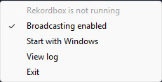

# Rekordbox Now Playing

A Windows tray app that reads the track currently playing in Rekordbox straight from its on-screen deck displays and reports it to an HTTP API, so a website (for example a song-request page) can show "now playing" live.



Rekordbox has no public API for the current track, so this app reads it off the screen the way a screen reader would, works out which deck is actually live, and only sends updates when something changes.

## How it works

```
Rekordbox window ──UI Automation──▶ scraper ──deck snapshots──▶ state machine ──decisions──▶ API client ──HTTPS──▶ server
```

1. **Reading the decks** ([app/scraper.py](app/scraper.py)). Rekordbox is built on JUCE, and JUCE exposes its widgets through Windows' accessibility layer. The app uses Microsoft UI Automation (via [`uiautomation`](https://pypi.org/project/uiautomation/)) to walk Rekordbox's accessibility tree and collect the text controls. The tree has no stable AutomationIds and is mostly flat, so decks are found by position. Each deck draws its title, artist, BPM and key followed by a remaining time (`-m:ss`) and an elapsed time (`m:ss`). The scraper anchors on those two timecodes and reads the fields just before them. The layout was reverse-engineered with the scripts in [dev_tools/](dev_tools/) (`dump_tree.py`, `scrape_live.py`, `scrape_scoped.py` and others), which dump and probe the live tree.
2. **Deciding what's playing** ([app/state.py](app/state.py)). Once a second, `PlaybackState.evaluate()` takes the deck snapshots and returns a `BroadcastDecision`: whether to send anything, and what to send. The rules are explained under [Design decisions](#design-decisions).
3. **Reporting** ([app/api_client.py](app/api_client.py)). Sends the decision to the configured endpoint as a JSON POST with a bearer token. A failed request is logged and the next change or heartbeat sends it again.

The tray UI ([app/tray.py](app/tray.py)) shows the current status and has toggles for broadcasting and for starting with Windows, plus a link to the log file. On launch it shows a tray notification confirming the app is running.

## Design decisions

**Playing means "elapsed went up by a plausible tick", not just "elapsed changed".** Rekordbox doesn't expose a play/pause state, so the app infers it from the elapsed timecode. Many things change that number without the track actually playing:
- Loading a track jumps it to the cue point. So when the title or artist changes, the app treats it as a load and marks the deck not playing.
- Seeking, needle drops and hot cues jump it forwards or backwards, often while the deck is paused, for example when previewing a mix point.

So a reading only proves playback if it moved forward by 1 to `MAX_PLAUSIBLE_TICK_SECONDS` (2 s) on the same track. A bigger or backwards jump on a deck that is *already* playing keeps it playing, because a hot cue in the middle of a track is normal. The same jump on a stopped deck proves nothing until a normal tick follows it.

**Pause detection is debounced.** The timecode only has 1-second resolution and polls aren't perfectly aligned with it, so a playing deck sometimes reads the same value twice in a row. A deck counts as paused only after `PAUSE_DEBOUNCE_POLLS` (2) unchanged readings in a row. That absorbs the jitter and only delays real pause detection by about a second.

**The reported deck is sticky during transitions.** In a mix, the next track starts playing on the other deck while the current one is still up. To the audience, the current track is still the one playing. So once a deck is being reported, it stays reported for as long as it keeps playing. The report switches to the other deck only when the outgoing track stops, and it goes straight to the new track with no "stopped" in between.

**Heartbeats.** While a track keeps playing, it is sent again every `HEARTBEAT_INTERVAL_SECONDS` (15 s). This lets the server tell "still playing" apart from "the laptop crashed or went offline", and it brings the server back in sync if an earlier request failed. A stop is sent only once, not repeated. On startup the app sends one "stopped" so stale state from an earlier session is cleared.

**A tray notification instead of a splash window.** An earlier version showed an animated Tkinter splash on launch. In the packaged exe, a native Tcl/Tk crash during that animation could kill the process before the tray icon appeared, and a Python `try`/`except` can't catch that kind of crash. pystray's own notification gives the same "it's running" signal without a second GUI toolkit.

## API

Each report is a JSON `POST` to the configured URL:

```http
POST /api/report-now-playing HTTP/1.1
Authorization: Bearer <your-api-token>
Content-Type: application/json

{"name": "Track Title", "artist": "Artist Name", "isPlaying": true}
```

When nothing is playing:

```json
{"isPlaying": false}
```

## Configuration

The API URL and token are read at startup. The first value found wins, checked in this order:

1. Environment variables `RNP_API_URL` and `RNP_API_TOKEN`
2. `config.json` next to `RekordboxNowPlaying.exe` (or in the repo root when running from source)
3. `%APPDATA%\RekordboxNowPlaying\config.json`

A config file looks like [config.example.json](config.example.json):

```json
{"apiUrl": "https://example.com/api/report-now-playing", "token": "replace-with-your-token"}
```

When the app is used with the song-request dashboard, the dashboard hands each DJ a `config.json` with their own token to put next to the exe. That way the same build works for everyone.

If no URL or token is found, the app still starts, but the tray icon turns purple ("Not set up"), broadcasting stays off, and the log at `%APPDATA%\RekordboxNowPlaying\log.txt` says where it looked.

Timing constants (poll interval, heartbeat, debounce) are in [app/config.py](app/config.py).

## Running from source

Requires Windows and Python 3.12.

```powershell
python -m venv venv
venv\Scripts\pip install -r requirements.txt
venv\Scripts\python main.py
```

## Building

```powershell
.\build.ps1
```

This produces `dist\RekordboxNowPlaying.zip`, which contains `RekordboxNowPlaying.exe` and its supporting files. It runs without Python installed. The build uses PyInstaller's `--onedir` mode rather than `--onefile`. A onefile exe unpacks itself into a temp folder at runtime, which antivirus heuristics associate with malware droppers, so `--onedir` reduces false positives. The exe is still unsigned, so Windows SmartScreen may warn on first run ("More info" → "Run anyway"). Code signing would fix that, but it needs a paid certificate.

[.github/workflows/build-release.yml](.github/workflows/build-release.yml) builds the zip on every push to `main` and publishes it as the `latest` GitHub Release.

## Tests

The state machine is covered by pure-Python tests in [tests/](tests/). They feed synthetic deck snapshots through `PlaybackState` and use a fake clock, so they need neither Rekordbox nor UI Automation:

```powershell
venv\Scripts\pip install -r requirements-dev.txt
venv\Scripts\python -m pytest
```

CI runs the same tests on `windows-latest` ([.github/workflows/tests.yml](.github/workflows/tests.yml)).

## Project layout

- `app/` – scraper, state machine, API client, tray UI, config
- `main.py` – entry point (single-instance guard, logging, tray)
- `tests/` – unit tests for the state machine
- `dev_tools/` – live diagnostics for mapping Rekordbox's accessibility tree (need a running Rekordbox; not part of the app)
- `build.ps1` – PyInstaller build and zip

## Limitations

- **Windows only.** It relies on Microsoft UI Automation.
- **Tied to Rekordbox's UI.** It reads what Rekordbox draws on screen, based on the current layout and accessibility tree. A Rekordbox update that changes the deck layout or what it exposes to accessibility can break detection. The `dev_tools/` scripts are the starting point for re-mapping it.
- Play/pause is inferred from the timecode, so detecting a pause takes about `PAUSE_DEBOUNCE_POLLS` seconds.
- The exe is unsigned, so antivirus software and SmartScreen may flag it. UI Automation, which reads text from other windows, adds to that suspicion.
